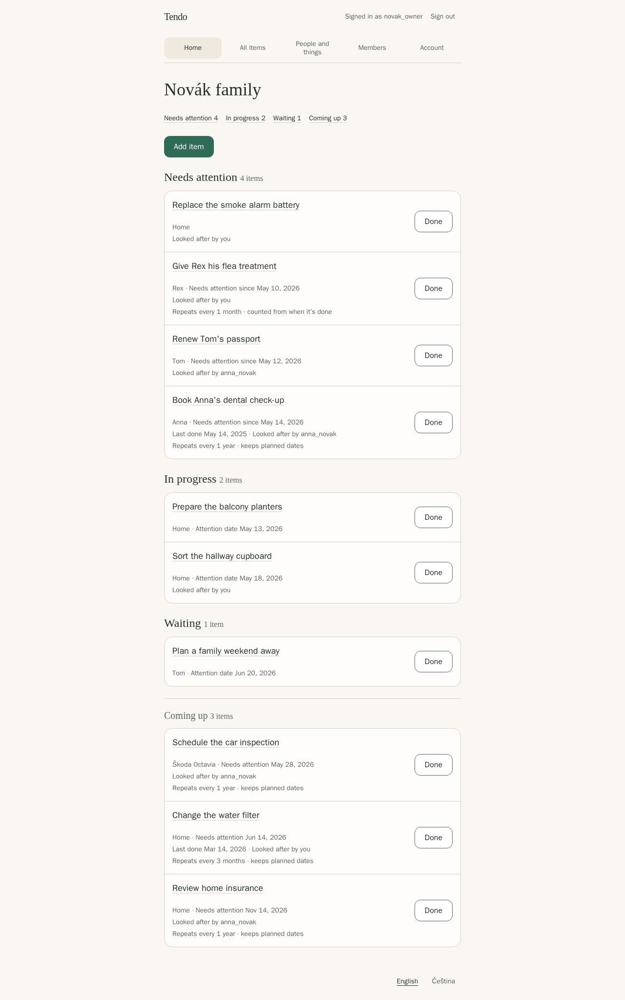

# Tendo

Tendo is a self-hosted shared list for the things a household needs to remember, without forcing everything into a calendar.



## What Tendo does

- Shows what needs attention first on Home, then what you are already handling or waiting on, then what is coming up. Each group shows how many items it has.
- Keeps one-off tasks visible until someone actually does them. Nothing disappears just because a date passed.
- Repeats a task when you turn on **Repeat**: on a fixed schedule, or counted from the day you last did it.
- Finds any item with **All items**: search titles and notes, and filter by status, by person or thing, by who is looking after it, and by whether it repeats. Search and counts cover every matching item, even in a household with thousands of items.
- Connects each item to the person or thing it is for, such as a family member, your home, a vehicle, or a pet, and to the household member looking after it.
- Keeps a history of completions, and lets you undo a completion you marked by mistake.
- Lets an owner invite the rest of the household with a private link. Tendo sends no email and needs no outside service.

The interface is available in English and Czech and works in a web browser on phones, tablets, and computers, with a keyboard, and with browser zoom.

## Quick start

These commands are for Linux with GNU sed. You need Docker Engine with the Docker Compose plugin 2.23.1 or newer, curl, and OpenSSL.

```sh
mkdir tendo
cd tendo
curl -fsSLO https://github.com/bigtcze/tendo/releases/latest/download/compose.yaml
umask 077
curl -fsSL -o .env https://github.com/bigtcze/tendo/releases/latest/download/example.env
sed -i \
  -e "s/^POSTGRES_PASSWORD=.*/POSTGRES_PASSWORD=$(openssl rand -hex 32)/" \
  -e "s/^TENDO_DATABASE_PASSWORD=.*/TENDO_DATABASE_PASSWORD=$(openssl rand -hex 32)/" \
  -e "s|^TENDO_SETUP_TOKEN=.*|TENDO_SETUP_TOKEN=$(openssl rand -base64 32)|" \
  .env
docker compose up -d --wait
```

Tendo now runs at `http://localhost:8080`, reachable only from this machine. Keep `.env` private; it holds your database passwords. The [installation guide](docs/admin/install.md) explains each step.

## First sign-in

Show your one-time setup code:

```sh
grep '^TENDO_SETUP_TOKEN=' .env | cut -d= -f2-
```

Open `http://localhost:8080` and enter the setup code, a name for your household, a login and password, and your time zone. Tendo creates your household and signs you in. If automatic sign-in fails, sign in with the account you just created. Then switch setup off:

```sh
sed -i 's/^TENDO_SETUP_TOKEN=.*/TENDO_SETUP_TOKEN=/' .env
docker compose up -d --force-recreate --wait app
```

## Use it from other devices

Tendo serves plain HTTP. To use it from phones or other computers, put it behind a reverse proxy that provides HTTPS, and set `TENDO_PUBLIC_URL` to your HTTPS address. Tested examples for Caddy, Nginx, and Traefik are in [reverse proxy](docs/admin/reverse-proxy.md). Never expose PostgreSQL.

## Update and back up

- [Update Tendo](docs/admin/update.md) — back up first, then pull the new image.
- [Back up and restore](docs/admin/backup-restore.md)

## Documentation

For households:

- [Items, Repeat, and history](docs/user/items.md)
- [People and things](docs/user/people-and-things.md)
- [Household members and invitations](docs/user/household-members.md)
- [Your account and sign-in](docs/user/account.md)

For whoever runs Tendo:

- [Install](docs/admin/install.md)
- [Configuration reference](docs/admin/configuration.md)
- [Reverse proxy](docs/admin/reverse-proxy.md)
- [Sign-in with OIDC, such as Pocket ID](docs/admin/oidc.md)
- [Troubleshooting](docs/admin/troubleshooting.md)

For contributors:

- [Development and tests](docs/development/testing.md), [runtime](docs/development/runtime.md), [frontend](docs/development/frontend.md), [API](docs/development/api.md), and [release process](docs/development/release.md)

Report problems in [GitHub issues](https://github.com/bigtcze/tendo/issues).

## Project status and license

This README describes Tendo 2.0, which is not released yet. The latest published release is 1.0.0, and the quick start above installs it until 2.0 is published. Tendo 2.0 will keep all your 1.x data; to update from 1.x once it is out, follow [Updating from 1.x to 2.0](docs/admin/update.md#updating-from-1x-to-20). When 2.0 is published, its images will be at `ghcr.io/bigtcze/tendo` with the tags `latest`, `v2`, `v2.0`, and the exact version; `v1` stays on 1.0.0. See [releases](https://github.com/bigtcze/tendo/releases) for changes. Tendo is licensed under the [Apache License 2.0](LICENSE).
