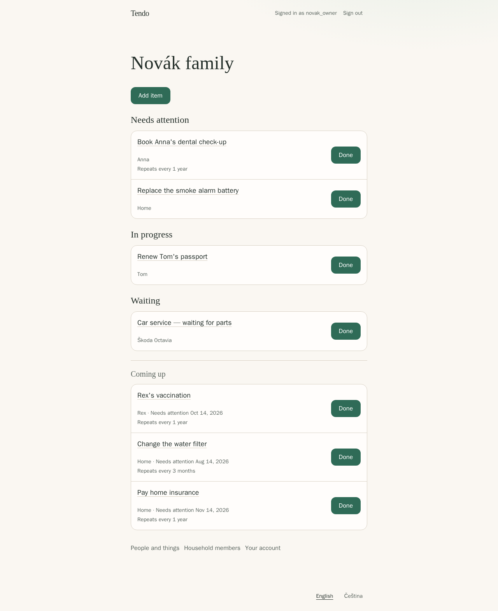

# Tendo

Tendo is a self-hosted shared list for the things a household needs to remember, without forcing everything into a calendar.



## What Tendo does

- Keeps one-off tasks visible until someone actually does them. Nothing disappears just because a date passed.
- Repeats a task when you turn on **Repeat**: on a fixed schedule, or counted from the day you last did it.
- Connects each item to the person or thing it is for: a family member, your home, a vehicle, a pet, or anything else.
- Shows what needs attention now, what is coming up, and what you are already handling or waiting on.
- Keeps a history of completions, and lets you undo a completion you marked by mistake.
- Lets an owner invite the rest of the household with a private link. Tendo sends no email and needs no outside service.

The interface is available in English and Czech and works on phones, tablets, and computers in a web browser.

## Quick start

These commands are for Linux with GNU sed. You need Docker Engine with the Docker Compose plugin, Git, and OpenSSL.

```sh
git clone https://github.com/bigtcze/tendo.git
cd tendo
umask 077
cp .env.example .env
sed -i \
  -e "s/^POSTGRES_PASSWORD=.*/POSTGRES_PASSWORD=$(openssl rand -hex 32)/" \
  -e "s/^TENDO_DATABASE_PASSWORD=.*/TENDO_DATABASE_PASSWORD=$(openssl rand -hex 32)/" \
  -e "s|^TENDO_SETUP_TOKEN=.*|TENDO_SETUP_TOKEN=$(openssl rand -base64 32)|" \
  .env
docker compose up -d --build --wait
```

Tendo now runs at `http://localhost:8080`, reachable only from this machine. Keep `.env` private; it holds your database passwords. The [installation guide](docs/admin/install.md) explains each step.

## First sign-in

Show your one-time setup code:

```sh
grep '^TENDO_SETUP_TOKEN=' .env | cut -d= -f2-
```

Open `http://localhost:8080` and enter the setup code, a name for your household, a login and password, and your time zone. Tendo creates your household and signs you in. If automatic sign-in fails, sign in with the account you just created. Then switch setup off:

```sh
sed -i 's/^TENDO_SETUP_TOKEN=.*/TENDO_SETUP_TOKEN=/' .env
docker compose up -d --force-recreate --wait app
```

## Use it from other devices

Tendo serves plain HTTP. To use it from phones or other computers, put it behind a reverse proxy that provides HTTPS, and set `TENDO_PUBLIC_URL` to your HTTPS address. Tested examples for Caddy, Nginx, and Traefik are in [reverse proxy](docs/admin/reverse-proxy.md). Never expose PostgreSQL.

## Update and back up

- [Update Tendo](docs/admin/update.md) — back up first, then pull and rebuild.
- [Back up and restore](docs/admin/backup-restore.md)

## Documentation

For households:

- [Items, Repeat, and history](docs/user/items.md)
- [People and things](docs/user/people-and-things.md)
- [Household members and invitations](docs/user/household-members.md)
- [Your account and sign-in](docs/user/account.md)

For whoever runs Tendo:

- [Install](docs/admin/install.md)
- [Configuration reference](docs/admin/configuration.md)
- [Reverse proxy](docs/admin/reverse-proxy.md)
- [Sign-in with OIDC, such as Pocket ID](docs/admin/oidc.md)
- [Troubleshooting](docs/admin/troubleshooting.md)

For contributors:

- [Development and tests](docs/development/testing.md), [runtime](docs/development/runtime.md), [frontend](docs/development/frontend.md), [API](docs/development/api.md), and [release process](docs/development/release.md)

Report problems in [GitHub issues](https://github.com/bigtcze/tendo/issues).

## Project status and license

Tendo is in active development and has no tagged release yet; the first version is not finished. See [LICENSE](LICENSE) for the license.
