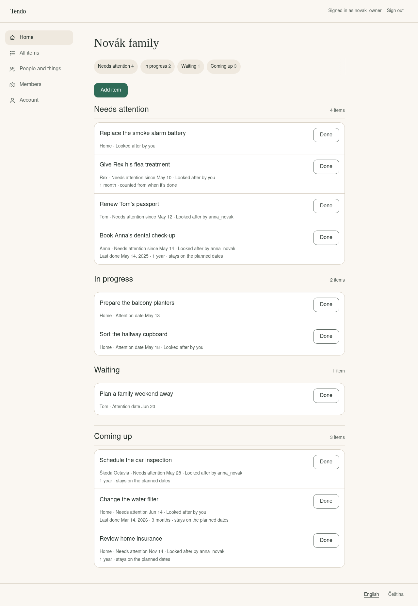

Tendo 3.0 is a redesign of every screen. The goal was to make Tendo easy to use for everyone in the household, including people who never set it up. Your data, your settings, and the way items repeat stay the same, and 3.0 does not change the database.

## What looks different

- **Room to work on computers and tablets.** Earlier versions showed every screen as a narrow phone-width column in the middle of a wide screen. On computers, Home, All items, People and things, Members, and Account are now in a sidebar on the left, and the content uses the space beside it. All items shows its search and filters beside the results.
- **Navigation within reach on phones.** On phones and tablets, the five household destinations are in a bar at the bottom of the screen with short labels (**Items**, **People**), instead of two wrapped rows of links at the top.
- **Easier to scan.** Each item shows its title first, in a stronger type. Who or what it is for, its date, and who is looking after it are on one line underneath. Repeat details have a second line only when the item repeats. On Home, attention dates leave out the year when it is the current year; the date an item was last done keeps it. Grey text is no longer used for everything that is not a title.
- **Less alike, more distinct.** Lists, forms, notices, and empty screens no longer all look like the same bordered box. The one main action on each screen is the only filled button.
- **Light and dark appearance.** Tendo follows your device's light or dark setting. In **Account**, under **Appearance**, you can choose **Light** or **Dark** for this browser instead. The chosen appearance is applied before the page is drawn, so it does not flash light first. Both appearances were designed separately, with their own checked colour contrast. Status is always also shown in words, not by colour alone.
- **Plainer words in English and Czech.** For example, sign-in asks for a **Username**, the setup screen explains where to find the one-time setup code, and the time zone is shown as a place name instead of a technical code. Repeating items say whether they **stay on the planned dates** or are **counted from when it’s done**.

## What works better

- **Mark an item done from its own page.** Item details now have **Done** as their main action, with **Undo** right after. Before, you could only mark items done on Home.
- **Adding and editing stay in place.** **Add item** and **Edit** open a form over the page (full screen on phones) instead of pushing the list down. Closing it returns you where you were.
- **Repeat explains itself.** When you turn on **Repeat**, one example sentence changes with your choice and shows what happens if you finish late. **Count the next repeat from when I complete this** is a separate switch, so a one-off item still needs no repeat settings at all.
- **Phone-friendly filters.** On phones, All items keeps search and **Show** visible and puts the other filters behind **Filters**. The button says how many filters are on, for example **Filters (1)**.
- **People and things.** Each entry has **See items**, which opens All items for that person or thing. **Archive** moved into the **Edit** dialog, so it is no longer next to **Edit** on every row. **Undo** and **Restore** still bring an entry back.
- **Members and invitations.** The members list explains what owners and members can do. An owner learns that an invite link works once and is shown only once before creating it. Pending invitations stand out from old ones, and **Revoke** asks **Revoke?** before it acts. Members who cannot invite are told to ask a household owner.
- **Clearer problems and recovery.** If Home cannot load at all, **Try again** replaces **Add item**, so an unavailable list no longer looks like an empty one. If a later refresh fails, the items already shown and **Add item** stay. A wrong sign-in says what to check and who can help with a forgotten password. An address that does not exist now shows a "We couldn’t find that page." screen with a way back, instead of silently showing Home.
- **Keyboard.** The keyboard reaches the page content before the household navigation. In the tested sample household, the first item on Home is now 8 Tab presses from the top of the page, down from 14 in 2.1. Focus is always visible.

## Also fixed

- A household name made only of invisible characters, such as a zero-width space, was accepted at first-run setup and showed up as an empty name. Household names now follow the same rules as names of people and things.

## Testing and quality

- Every feature from 2.1 is still covered by tests, and none of those tests was weakened to fit the new design. Tests that changed or were removed during 3.0 are listed with their reasons in the [V3 regression audit](https://github.com/bigtcze/tendo/blob/v3.0.0/docs/development/v3-regression-audit.md).
- Automated browser tests run the production build against a real PostgreSQL database. They cover phones, tablets, and computers at 320 to 1440 pixels wide, 200 % and 400 % browser zoom, English and Czech, light and dark, and households with more than 1000 items. They also check contrast, keyboard focus, and touch target sizes. A main journey also runs in Firefox and WebKit.
- New screenshot comparisons check the main screens at several widths in light and dark, so an unintended visual change is caught before release.
- Before each release, an automated run with the Orca screen reader on Linux checks selected headings, navigation, and search controls in English and Czech.
- The design was reviewed by AI reviewers working from real screenshots of the app. No household members or screen-reader users have tested this release, and none of these checks is a formal accessibility certification.

## Updating from 2.x

Your data is kept, and no new settings are required. 3.0 does not change the database, so you can go back to 2.1 without restoring a backup. Back up first anyway ([how](https://github.com/bigtcze/tendo/blob/v3.0.0/docs/admin/backup-restore.md#back-up)).

If `TENDO_VERSION` in `.env` is `latest`, the [update steps](https://github.com/bigtcze/tendo/blob/v3.0.0/docs/admin/update.md#update) install 3.0. If it is `v2`, `v2.1`, `v2.0`, or an exact 2.x version, change it to `v3` or `latest` first. `v2` never installs 3.0 on its own. Details: [Updating from 2.x to 3.0](https://github.com/bigtcze/tendo/blob/v3.0.0/docs/admin/update.md#updating-from-2x-to-30).

From 1.x, first read [Updating from 1.x to 2.0](https://github.com/bigtcze/tendo/blob/v3.0.0/docs/admin/update.md#updating-from-1x-to-20), which explains the database changes and PostgreSQL extension requirements. Then set `TENDO_VERSION` to `v3` or `latest`; the update steps install 3.0 directly.

Signed-in sessions stay valid after the update. Your appearance choice is new, so every browser starts by following the device setting.

## For API clients

The `/api/v1` endpoints and response formats stay compatible with 2.1. First-run setup (`PUT /api/v1/auth/setup`) has one stricter check: a `householdName` containing format characters (such as zero-width or bidirectional marks) or line or paragraph separators is rejected with `invalid_characters`, as `api/openapi.yaml` describes.

## Install

The install steps have not changed. See the [installation guide](https://github.com/bigtcze/tendo/blob/v3.0.0/docs/admin/install.md).

## Image

`ghcr.io/bigtcze/tendo`, for `linux/amd64` and `linux/arm64`. The automated tests, including clean installation and updates from the published 1.0.0 and 2.1.0 images, run on `linux/amd64`. The `linux/arm64` image is built from the same source by the release pipeline but is not run by the automated tests.

| Tag | Follows |
| --- | --- |
| `latest` | The newest release. This is the default in `compose.yaml`. |
| `v3` | The newest 3.x release. |
| `v3.0` | The newest 3.0.x release. |
| `v3.0.0` | This release only. |
| `v2`, `v2.1` | Stay on 2.1.0. |
| `v2.0` | Stays on 2.0.0. |
| `v1` | Stays on 1.0.0. |

## Known limitations

- Dark appearance needs Chrome or Edge 123, Firefox 120, Safari 17.5, or newer. Older browsers show the light appearance.
- The appearance choice is saved in each browser, not in your account.
- Two people marking the same item done at the same moment is handled correctly by the server and tested there, but it is not tested with two real browsers.

## Not included

- Notifications or reminders outside the app.
- More than one household per account in the interface.
- Password reset. Keep passwords in a password manager.
- TLS. Tendo serves HTTP and expects a reverse proxy in front of it.
- Running under a URL path prefix.

## Assets

- `compose.yaml`: Compose file for PostgreSQL 18 and Tendo.
- `example.env`: settings template. Save it as `.env`.
